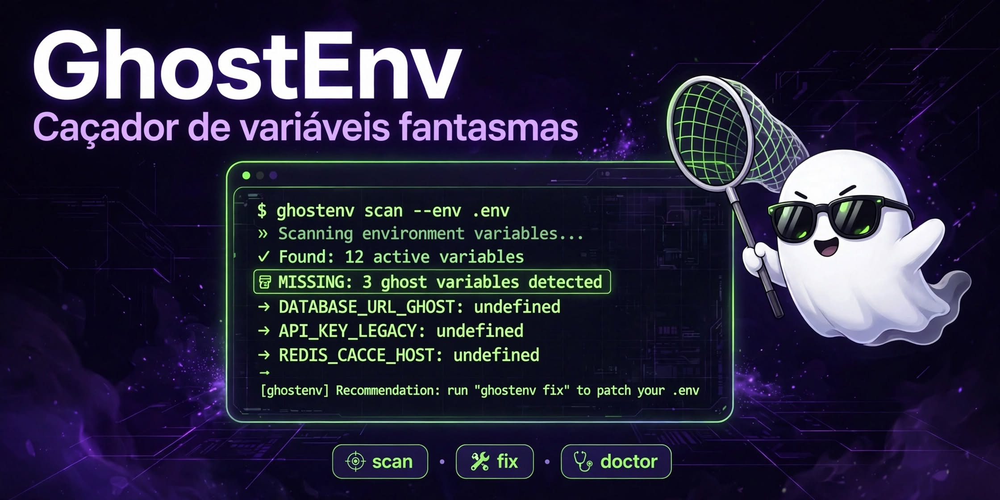

# 👻 GhostEnv — Caçador de Variáveis Fantasmas

> Rode no seu repo e me fala quantos fantasmas você achou.

[](LICENSE)
[](https://python.org)

Todo dev já quebrou o projeto por causa de um `.env` desatualizado.

O `.env.example` mente. O código não.

**GhostEnv lê seu código com AST de verdade** e te fala:
- ❌ Qual variável o código usa mas **não está no seu .env**
- 📝 Qual está no seu `.env` mas **nunca foi documentada**
- 💀 Qual está no `.env` mas **ninguém usa mais** (morta)
- 🔑 Qual é segredo e precisa de atenção

## ⚡ Em 10 segundos

```bash
pip install ghostenv
cd seu-projeto
ghostenv scan
```

```
👻 GhostEnv — 42 arquivos • 12 vars no código • 8 no .env
❌ FALTANDO: STRIPE_WEBHOOK_SECRET (usada em payments.py:42)
⚠️ Falta no .env: OPENAI_API_KEY
💀 Morta: OLD_API_KEY (no .env mas nunca usada)
```

## 🛠️ Comandos

| Comando | O que faz |
|---|---|
| `ghostenv scan` | Mostra fantasmas, mortas e segredos |
| `ghostenv scan --json` | Saída JSON pra CI |
| `ghostenv scan --fail-on-ghost` | Exit 1 se houver fantasma — perfeito pra GitHub Actions |
| `ghostenv fix` | Gera um `.env.example` perfeito a partir do código real |
| `ghostenv doctor` | Cria um `.env` local com valores FAKE pra testar sem quebrar |

## 🔥 Pra CI (GitHub Actions)

```yaml
- run: pip install ghostenv
- run: ghostenv scan --fail-on-ghost
```

Se alguém abrir PR usando `os.getenv("NOVA_VAR")` sem atualizar o `.env.example`, o CI quebra.

## 🌍 Linguagens

| Linguagem | Status |
|---|---|
| Python (`os.getenv`, `os.environ[]`) | ✅ |
| JS / TS (`process.env`, `import.meta.env`, `Bun.env`) | ✅ |
| Go, Rust, PHP, Java, Ruby | 🟡 Quer contribuir? Veja `CONTRIBUTING.md` |

## 🤝 Contribua — Good First Issue

Adicione **uma linguagem**: crie `examples/<linguagem>/`, adicione o pattern em `ghostenv/scanner.py`, abra o PR.

## 📦 Instalação dev

```bash
git clone https://github.com/LuizDevkit/ghostenv
cd ghostenv
pip install -e .
ghostenv scan examples/python
```

## ⭐ Se te salvou de um bug, deixa a estrela


E comenta na Issue #1: **"Achei X fantasmas no meu repo"**

---

Feito por [LuizDevkit](https://github.com/LuizDevkit) • [LinkedIn](https://www.linkedin.com/in/antonio-brito-dev)
